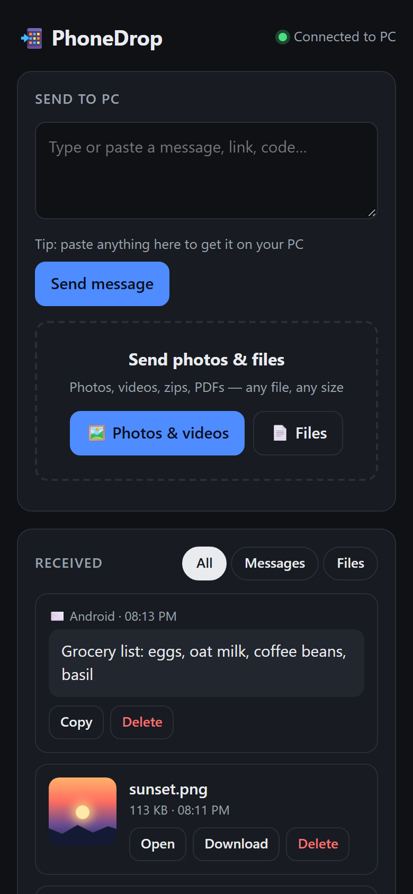

# PhoneDrop

Send messages, photos, videos, zips — any file — from your phone to your PC over your home Wi-Fi.
No account, no cloud, nothing to set up.

<p align="center">
  
  &nbsp;
  
</p>
<p align="center"><sub>Left: the PC page with the pairing QR code. Right: the phone after scanning it.</sub></p>

## Download (Windows)

Grab `PhoneDrop-Setup-x.y.z.exe` from the [Releases](https://github.com/basarsy/phoneDrop/releases) page and run it.
It installs PhoneDrop as a desktop app with a Start Menu and desktop shortcut. The installer is unsigned, so
Windows SmartScreen may warn you: click **More info → Run anyway**.

PhoneDrop opens in its own window with a QR code. Scan it with your phone camera and the phone is paired
(it remembers via a cookie). Then send text or pick photos/files, and they show up on the PC instantly.

- **Closing the window keeps PhoneDrop running in the system tray**, so phones can still send files. Use the tray
  icon to reopen it, open the received folder, change the folder, turn on *Start with Windows*, or **Quit**.
- You get a desktop notification when a phone sends a file or message.
- Files are saved to `%USERPROFILE%\Downloads\PhoneDrop` by default. Change it with **Change folder…** in the app.
- Clicking **Open** on a received file opens it in its default app.
- Works both ways: anything sent from the PC appears in the phone's feed too.

## Run from source

```
npm install
npm run app           # the desktop app (Electron)
npm start             # or just the server, no Electron: node server.js / start.bat, opens a browser tab
```

## Build

```
npm run build         # -> release/PhoneDrop-Setup-<version>.exe (Electron app + NSIS installer)
npm run build:sea     # -> dist/PhoneDrop.exe (lightweight server-only exe: a console window plus a browser tab)
npm run icon          # regenerate the app icons in build/ and electron/
```

When running the server without the app, it uses these environment variables: `PORT` (default `8765`),
`PHONEDROP_DIR` (save folder) and `NO_OPEN=1` (don't open a browser tab).

## First run on Windows

Windows Firewall will ask whether PhoneDrop (or Node.js / Electron, when run from source) may accept connections — allow it on **Private networks**.
If your phone can't connect, make sure the Wi-Fi network is set to *Private* in Windows settings and
both devices are on the same network.

## Security

Only devices that scanned the QR code (which carries a secret token) can view or send anything; requests
from the PC itself are always allowed. The token is stored in `%APPDATA%\PhoneDrop\token` for the desktop app
(`PhoneDrop\.phonedrop\token` when running the server alone). Delete it and restart to unpair all phones. Traffic is plain HTTP on your LAN, so use it on networks you trust.
