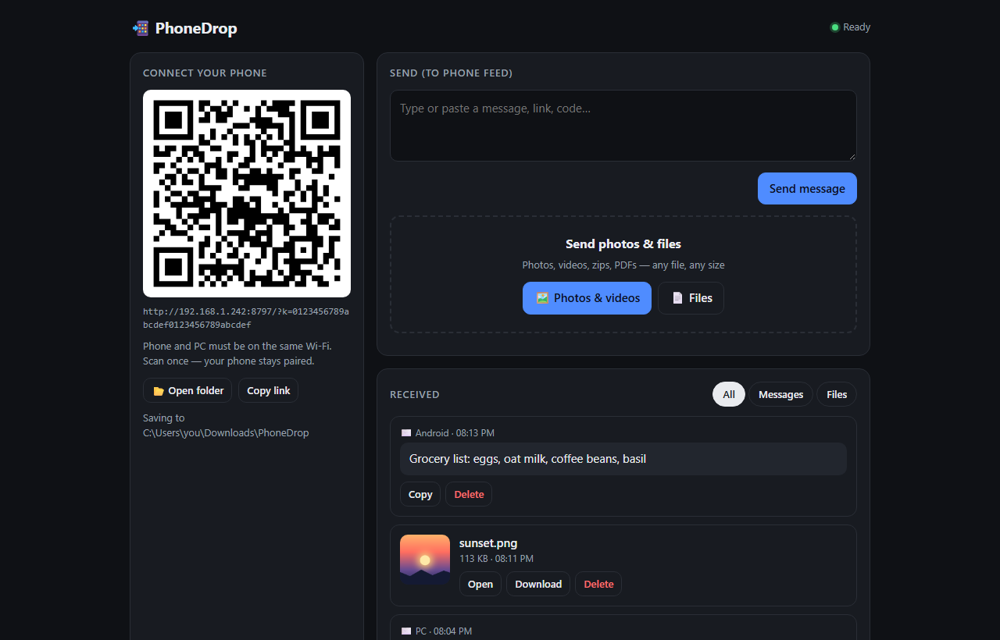

# PhoneDrop

Send messages, photos, videos, zips — any file — from your phone to your PC over your home Wi-Fi.
No account, no cloud, no dependencies.

<p align="center">
  
  &nbsp;
  
</p>
<p align="center"><sub>Left: the PC page with the pairing QR code. Right: the phone after scanning it.</sub></p>

## Download (Windows)

Grab `PhoneDrop.exe` from the [Releases](https://github.com/basarsy/phoneDrop/releases) page and double-click it —
no Node.js install needed. The exe is unsigned, so Windows SmartScreen may warn you: click **More info → Run anyway**.

## Run from source

```
node server.js        # or double-click start.bat
```

## Build the exe

```
npm run build         # -> dist/PhoneDrop.exe (Node.js single executable application)
```

A browser tab opens on the PC with a QR code. Scan it with your phone camera — the phone is now paired
(it remembers via a cookie). Then send text or pick photos/files; they show up on the PC instantly.

- Files are saved to `%USERPROFILE%\Downloads\PhoneDrop` (change with `PHONEDROP_DIR`).
- Port defaults to `8765` (change with `PORT`). Set `NO_OPEN=1` to skip opening the browser.
- Works both ways: anything sent from the PC page appears in the phone's feed too.

## First run on Windows

Windows Firewall will ask whether PhoneDrop (or Node.js, when run from source) may accept connections — allow it on **Private networks**.
If your phone can't connect, make sure the Wi-Fi network is set to *Private* in Windows settings and
both devices are on the same network.

## Security

Only devices that scanned the QR code (which carries a secret token) can view or send anything; requests
from the PC itself are always allowed. The token is stored in `PhoneDrop\.phonedrop\token` — delete it and
restart to unpair all phones. Traffic is plain HTTP on your LAN, so use it on networks you trust.
